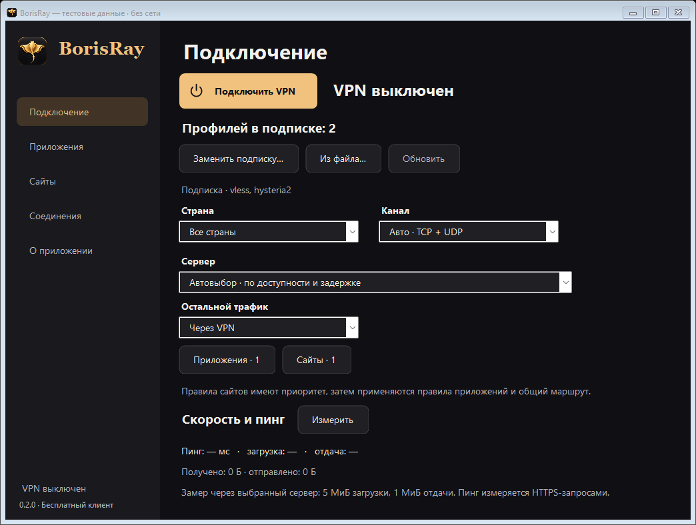

# BorisRay for Windows

Free provider-neutral Windows 11 x64 VPN subscription client, using native Windows Forms and the official unmodified sing-box 1.14.3 core. Independent client; no affiliation with SagerNet or Amnezia. No subscription or server administrator credential is included.

Features: HTTPS subscription URLs, plain/Base64 link lists, Xray and sing-box JSON, Clash YAML; VLESS TCP/TLS/Reality, VMess, Trojan, Shadowsocks AEAD/2022, Hysteria2, TUIC and SOCKS5; WebSocket/gRPC/HTTP/HTTPUpgrade for V2Ray protocols; explicit country profiles, process executable/folder rules, domain rules with matching DNS policy, local connection inspection, bounded HTTPS throughput/latency probe, and manual BorisRay update checks. Subscriptions use Windows CurrentUser DPAPI. The system tunnel needs elevation; this version requests UAC at launch.

See [Russian installation instructions](README.txt). This release still requires a real Windows 11 network acceptance test; native CI rendering and `sing-box check` do not prove successful TUN connectivity.

## Subscription compatibility

Paste the provider's HTTPS URL into “Добавить по ссылке…”, then connect. HTTPS URLs are preserved exactly, including provider query tokens; requests identify the supported sing-box core. Explicit plain `happ://add/https…` wrappers can also be pasted. Server groups/listeners/DNS/routes from provider JSON/YAML are not executed; only standalone server definitions are imported, preserving BorisRay app/site rules. The whole import is validated before replacing the DPAPI profile.

Encrypted `happ://crypto…`, XHTTP/mKCP/V2Ray QUIC, external Shadowsocks plugins, proxy chains and configurations disabling certificate validation are currently unsupported. This is not full Happ parity. JSON may contain full Xray configurations or sing-box outbounds; YAML must include `proxies` rather than only external `proxy-providers`. Limits: 1 MiB and 256 servers; bounded JSON/YAML depth and alias expansion. Provider-specific device registration/paywall policies may require an export supported by the provider.

## Install

Use `BorisRay-Windows-Setup-x64-0.2.0.exe` for Program Files installation, Start menu shortcut and Windows uninstall registration. Optional desktop shortcut. Reinstalling the same AppId upgrades in place. User DPAPI data is kept on uninstall. The installer and client are unsigned, so SmartScreen/UAC may show an unknown publisher. A portable ZIP remains available.

## Build and checks

On Windows x64 with .NET SDK 10.0.402 and PowerShell 7 and Inno Setup 6:

```powershell
./Scripts/build.ps1 -Capture
```

The script downloads the official core release with pinned archive, executable and DLL SHA256 checks. It runs the portable parser/routing tests, validates every generated synthetic protocol/configuration fixture with the Windows core, publishes a self-contained client plus an Inno Setup installer, smoke-tests installation/uninstallation and captures the actual WinForms controls at desktop/compact sizes. The isolated capture executable cannot start a VPN. Artifacts contain only synthetic `.example` data and expire after three days in Actions.

Portable tests can also run on macOS/Linux with `dotnet run --project tests/BorisRay.Tests.csproj -c Release -- config-checks`.

The core's full corresponding source at tag v1.14.3, commit `7054cac5124465ffdb145870d7c01885566711b1`, is supplied in the release source ZIP. [Upstream source](https://github.com/SagerNet/sing-box/tree/v1.14.3), [official release](https://github.com/SagerNet/sing-box/releases/tag/v1.14.3). See [LICENSES.txt](LICENSES.txt) for dependencies and source availability.

## Native Windows preview

Synthetic test subscription, actual Windows Forms capture from CI; no VPN started.



[Windows build and native checks](https://github.com/nikokoi90/borisray-windows/actions/runs/39165560755). Full capture metadata and explicitly simulated pending-route states: `.impeccable/review/windows/`.
